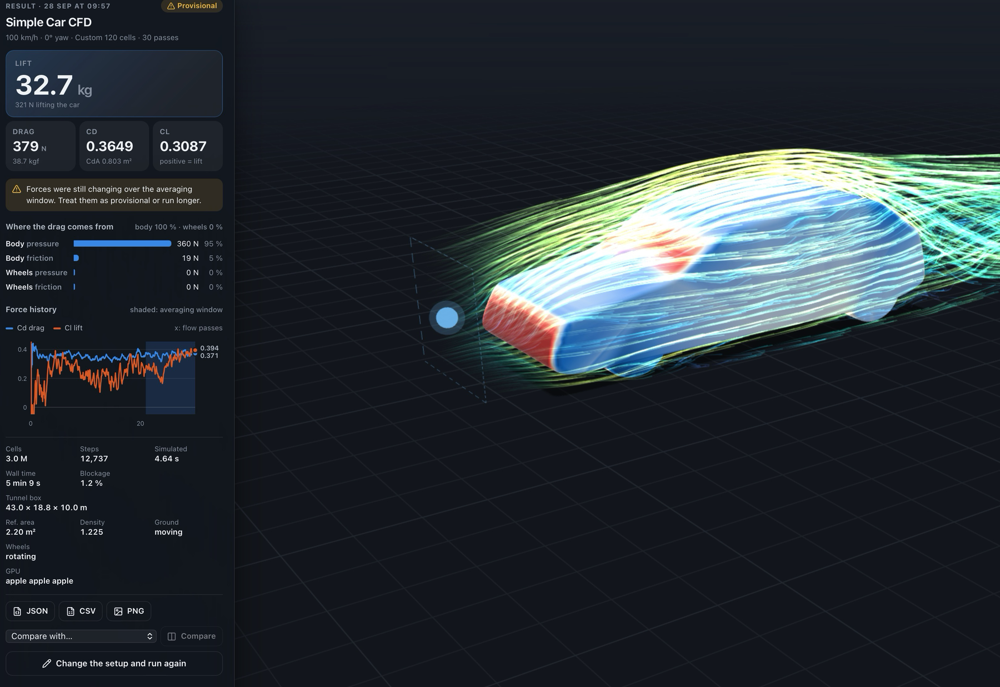
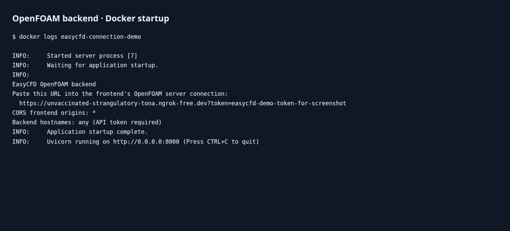
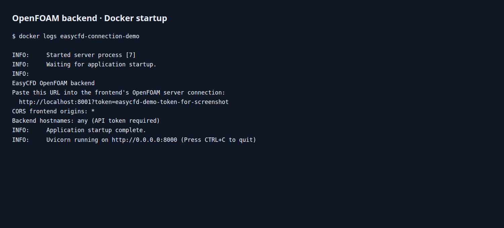

# EasyCFD

Explore airflow around a car or a part. Compare drag, downforce, and design changes in a browser wind tunnel.

[**Open EasyCFD**](https://easy-cfd.mthracelab.com/)



## Start here

1. Load the sample car, or import an STL, OBJ, GLB, or glTF model.
2. Check the model's units and orientation. Set the speed and yaw angle.
3. Run a simulation. Inspect the results and airflow. Compare two runs to study a change.

The public app uses WebGPU. It needs a browser and device with WebGPU support. It stores projects in your browser.

Treat the results as exploratory estimates. They do not establish real vehicle loads or aerodynamic accuracy. Read the [validation notes](web/VALIDATION.md) before you use the numbers for a design decision.

## Aero overview

After a run, choose **Explore airflow → Aero overview** to see surface pressure and thin, speed-coloured streamlines around the car and through its wake. Each field has its own scale. Adjust the line density, thickness, colours and local wake seeds in Settings; PNG exports include both legends.

This view uses the saved steady velocity field. Wake detail depends on what the simulation resolves.

## Run locally

Use Node.js 22 and npm.

```sh
cd web
npm ci
npm run dev
```

OpenFOAM is an optional engine. The UI supports both a native server and a token-protected backend URL, including in builds with native OpenFOAM disabled. See the [technical guide](TECHNICAL_GUIDE.md) for model preparation, solver options, and development checks.

The public frontend deploys automatically when a pull request is merged into `main`, using the [Cloudflare Pages workflow](.github/workflows/cloudflare-pages.yml). It runs the frontend checks and build before publishing to the existing Pages project. Repository Actions secrets `CLOUDFLARE_API_TOKEN` and `CLOUDFLARE_ACCOUNT_ID` are required; see the [deployment setup](TECHNICAL_GUIDE.md#two-engines-webgpu-and-openfoam). You can also run the workflow manually on `main`, or use `just deploy-web` from a machine with `~/.env.cloudflare`.

## Run an OpenFOAM backend with Docker

You can use the static frontend at **https://easy-cfd.mthracelab.com/** with a backend running on **your own computer**. In the Run step, expand **OpenFOAM server connection**, paste `http://localhost:8000?token=YOUR_TOKEN`, and click **Connect remote server**. Select OpenFOAM once it connects. No ngrok tunnel is needed when the browser and Docker backend run on the same computer. If the browser asks for permission to access the local network, allow it for this connection.

Install Docker with Compose, then from this checkout:

```sh
# Use an absolute, persistent path on the machine running the Docker daemon.
export EASYCFD_HOST_DATA="$PWD/.easycfd-remote"
mkdir -p "$EASYCFD_HOST_DATA"

# Download the pinned OpenFOAM v2412 solver image (separate from the API image).
docker pull opencfd/openfoam-default@sha256:1ba02114b1c025c370f2e269a07677c16c9bea8d990fcd75ac8378aff9d41b50

# Build the backend image, then start its single-worker API and persistent queue.
docker compose build backend
docker compose up -d backend

# The startup log prints the full URL to paste into the frontend, including its token.
docker compose logs backend
```

Without `EASYCFD_API_TOKEN`, a random token is generated on first start. It is saved in `/data/.api-token` and reused after restarts. The startup log shows a copyable URL such as `http://localhost:8000?token=…`; a custom `EASYCFD_PORT` is reflected in that URL. To choose a token instead, set `EASYCFD_API_TOKEN` before starting the container, or put it in a local `.env` file:

```sh
export EASYCFD_API_TOKEN='replace-with-a-long-random-secret'
docker compose up -d backend
```

Use this value in the connection URL. The token grants access to all projects and runs on that backend. API requests require the token, including health checks, uploads, cancellations and result downloads. The UI extracts it from the URL and sends it as a bearer authorization header; it keeps the connection in this browser tab's session storage and does not export the token with projects or results. OpenFOAM runs upload the selected model to your backend; WebGPU runs compute in the browser.

The Compose service listens on loopback by default. It uses the host Docker socket to launch isolated solver containers, so run it on a machine you trust. The API and solver share the persistent data directory; `EASYCFD_HOST_DATA` must identify that directory on the Docker daemon's host. You can also build the API image directly with `docker build -t easycfd-backend:local .`. Stop the service with `docker compose down`; saved runs and the generated token stay in the data directory.

## Connect to a backend on another computer

Use a reachable **HTTPS** backend URL such as `https://cfd.example.com?token=YOUR_TOKEN` (an `/api` suffix is also accepted). A public server with HTTPS through a reverse proxy needs no tunnel. For a backend behind NAT or a firewall, ngrok or a similar HTTPS tunnel can expose the loopback service:

```sh
# After installing ngrok and configuring its account credentials:
ngrok http http://localhost:8000
```

Paste the HTTPS forwarding URL with `?token=YOUR_TOKEN` into **OpenFOAM server connection**. The UI supports ngrok's browser-warning bypass header. Keep the tunnel running while using the backend; queued runs continue on the backend if you close the UI. See the [ngrok HTTP guide](https://ngrok.com/docs/getting-started/) for account setup.

To have the backend print the internet connection URL, set its public address and recreate the API container:

```sh
export EASYCFD_PUBLIC_URL=https://your-ngrok-domain
docker compose up -d backend
docker compose logs backend
```

The startup log now prints `https://your-ngrok-domain?token=…`. `EASYCFD_PUBLIC_URL` only controls the advertised address; it works with any HTTPS hostname or an API prefix supplied by your proxy, and does not create a tunnel. The startup URL includes the access token, so share it only with people who should use this backend.



For direct hosting, forward `/api/*` to the backend and preserve the `Authorization` and `Origin` headers. If you publish Docker's port, configure HTTPS at the proxy. Remote mode accepts **any backend hostname**. CORS permits **any frontend origin by default** (`Access-Control-Allow-Origin: *`), including authorization-header preflights; every API request still requires a valid token. `EASYCFD_CORS_ORIGINS` optionally restricts browser access to comma-separated frontend origins, for example `https://easy-cfd.mthracelab.com,http://localhost:5173`; an unset or blank setting permits all origins, without cookies. Internet connections require HTTPS; HTTP is accepted for `localhost`, `127.0.0.1` and `[::1]` only.

The existing `just run-openfoam` native setup still works. `VITE_ENABLE_OPENFOAM=true` enables automatic same-origin discovery; `false` disables that discovery while keeping the remote connection option available. **Use native server** switches back to same-origin access, or **Disconnect** returns a static build to WebGPU.

To repeat the browser smoke test against your Compose backend, build the static UI, install Chromium, and run:

```sh
npm --prefix web ci
VITE_ENABLE_OPENFOAM=false npm --prefix web run build
npx --prefix web playwright install chromium
node scripts/test-remote-openfoam.mjs
# Or test over a running tunnel:
EASYCFD_REMOTE_URL=https://your-ngrok-domain node scripts/test-remote-openfoam.mjs
```

This serves the checkout's static build at the public HTTPS origin inside the test browser, makes real requests to your backend, runs Fast, and saves UI screenshots and verification records under `test-results/remote-openfoam/`. It does not publish the frontend. Set `EASYCFD_REMOTE_TOKEN` when testing a backend outside the default Compose container, or `EASYCFD_CONNECTION_ONLY=true` to check the connection without starting a simulation.

The backend startup screen shows the URL to paste (the screenshot uses a temporary demonstration token):



## Recorded airflow and local OpenFOAM runs

Enable **Record flow animation** to replay computed airflow in the 3D view. Standard recordings store 48 physical-time frames. The local OpenFOAM engine also offers **Detailed wake**: a dedicated mesh, DDES and approximately 192 frames on four dense sections. Select a section during playback; the selected section is saved for offline use. See [recording and video validation](docs/fine-airflow/README.md).

OpenFOAM analysis uses four cards: **Fast**, **Medium**, **Precise** (Advanced 1) and **Very Precise** (Advanced 2). Medium has a 20-minute whole-job ceiling including standard recording; unfinished results remain provisional or incomplete. The [measured Medium run](docs/medium-runtime.md) completed in 9 minutes on the tested model and machine. Detailed wake has a separate, longer budget.

In the library's **OpenFOAM server** tab, click a running or queued run to reopen its progress and saved car geometry. The run continues on the server when you close the browser.
