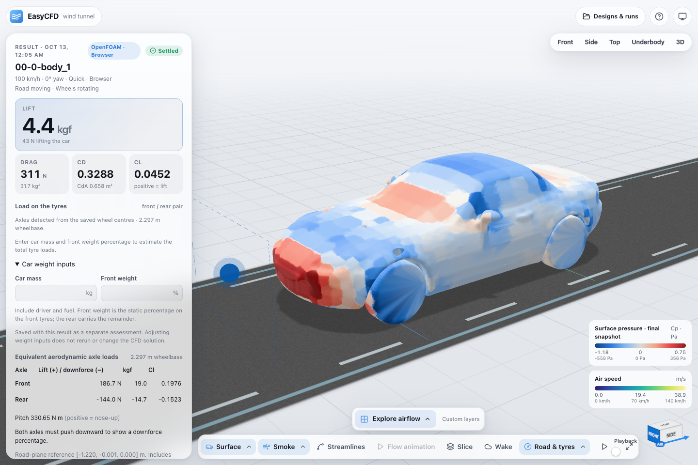
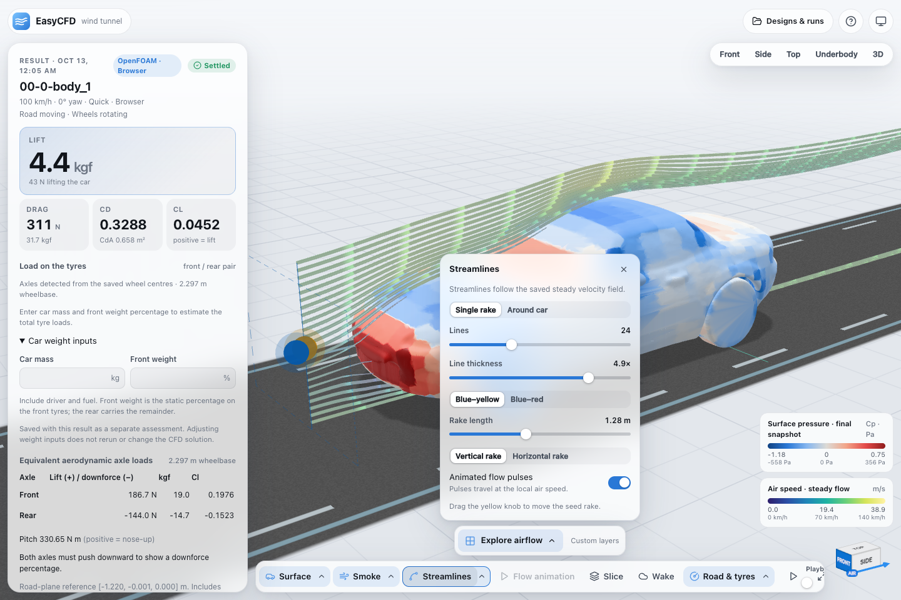
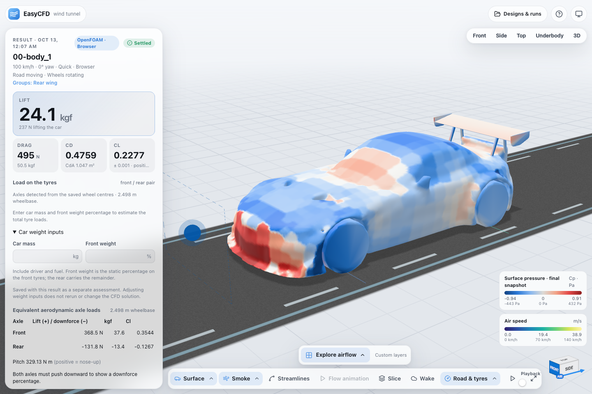
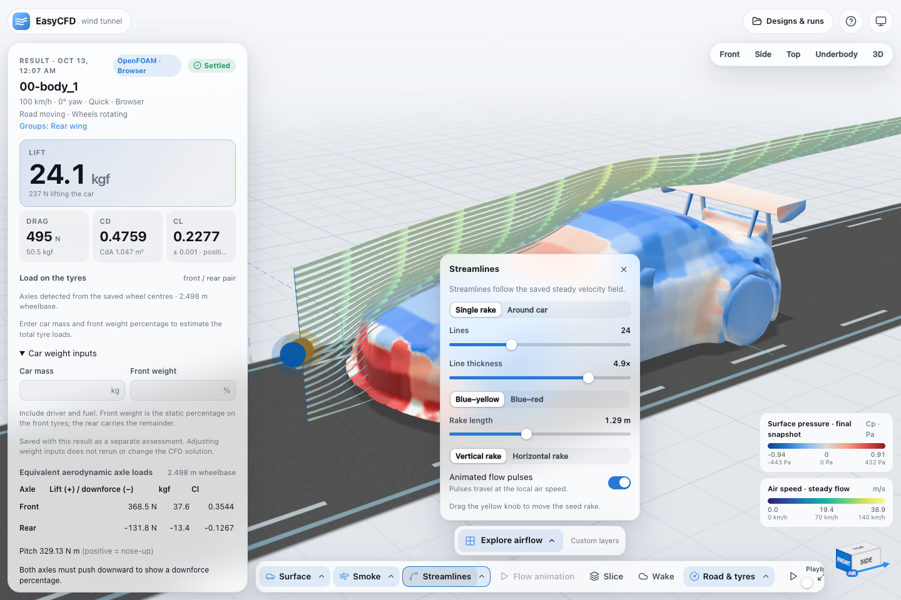
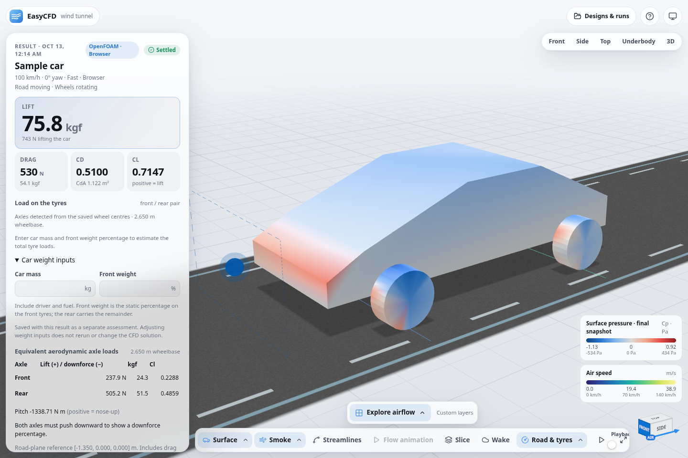
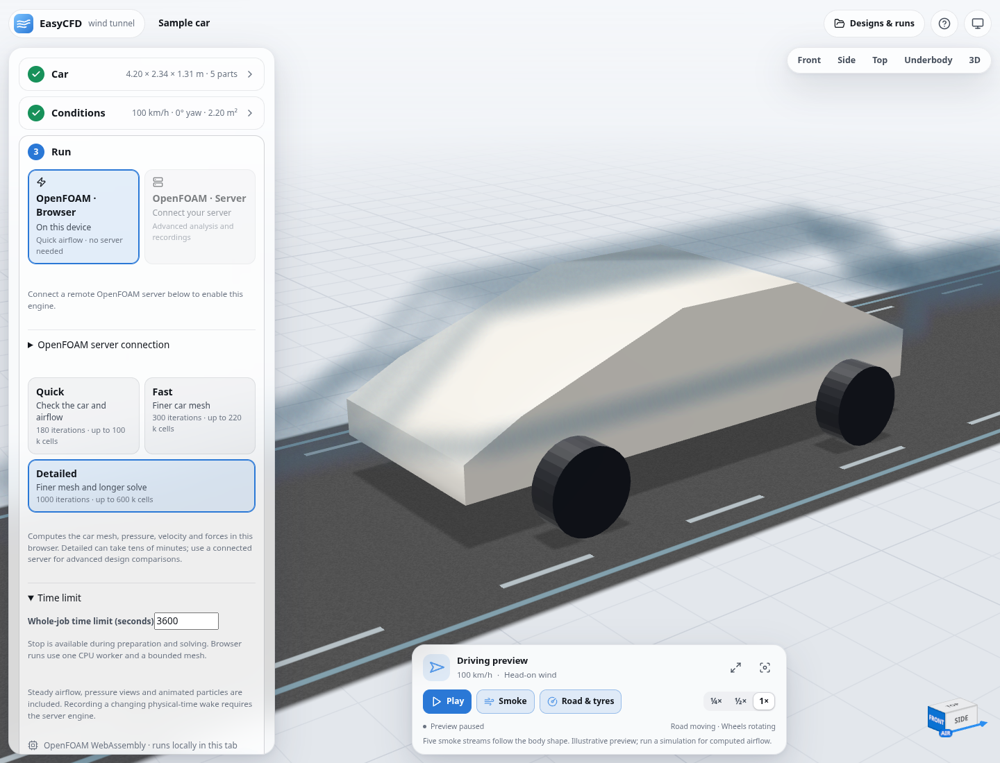
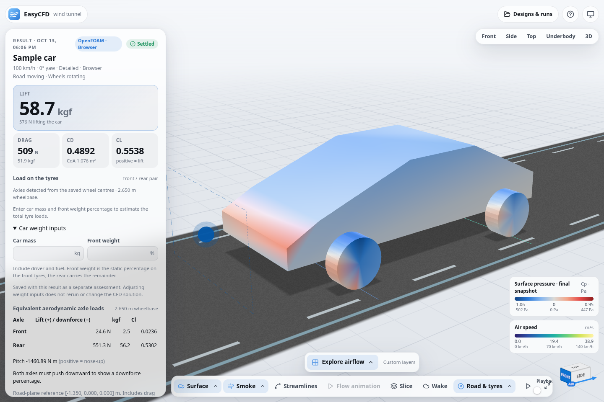

# Browser OpenFOAM evidence

The isolated worktree is based on origin/main commit
`5fb0cb09a1a3b4bfa99203d4956f3dc199bc0933`. It replaces the public WebGPU run
path with OpenFOAM WebAssembly, while keeping the native/remote API and viewer
contracts. Quick, Fast and Detailed are the browser presets; Detailed has a
600,000-cell ceiling and 1,000 iterations.

The file-only production test disables WebGPU and blocks API/off-origin
requests. The Mac Mini checks cover the MX-5, Z4 with all wing parts, and Ahmed
body, including computed fields, per-part wall values and saved result reopening.
[Machine-readable Mac checks](mac-verification.json) include hardware, timings,
coefficients and request records. [Native parity](native-parity.json) compares
four captured meshes with stock OpenFOAM v2512.

Detailed completed all 1,000 iterations on Linux and the Mac Mini with 348,352
cells, taking 28.3 and 29.7 minutes respectively. Both reopened saved results;
the sample retained prism layers on 98.2% of its car wall. Quick also passed
through a Tailscale HTTPS preview served directly from static files.
[Detailed and Tailscale checks](detailed-verification.json) record the results,
hardware, fields and lack of API/WebGPU usage. The Detailed tests used a
30-minute cap; the final preset allows an hour for larger imported models.

## Screenshots

## Unedited recordings

- [MX-5 static OpenFOAM run](mx5-static-openfoam.mp4)
- [Z4 static OpenFOAM run](z4-static-openfoam.mp4)

These are browser recordings converted to H.264 without changing playback
speed. They show the actual import, local solve, results, visualization and
reopening. Streamline/particle movement displays the computed steady field;
physical-time wake recordings require the connected backend.

The native comparisons establish equivalence on these meshes. Light meshes
still need grid and physical validation before design claims. The sample Fast
case retained no prism layers; its warning and measured coverage are preserved.
See [the full validation notes](../../web/VALIDATION.md).

## Hosting and reproduction

`VITE_ENABLE_OPENFOAM=false npm --prefix web run build` produces `web/dist/`.
Host the entire directory statically, including `openfoam/`. No API, Cloudflare
Function or compute backend is required for the browser engine. Modules are
precompiled, compressed, checked by SHA-256, and loaded into a local worker.

The native backend connection flow was also checked from an HTTPS static
frontend against the existing Docker backend. No production deployment or main
worktree change was made.
